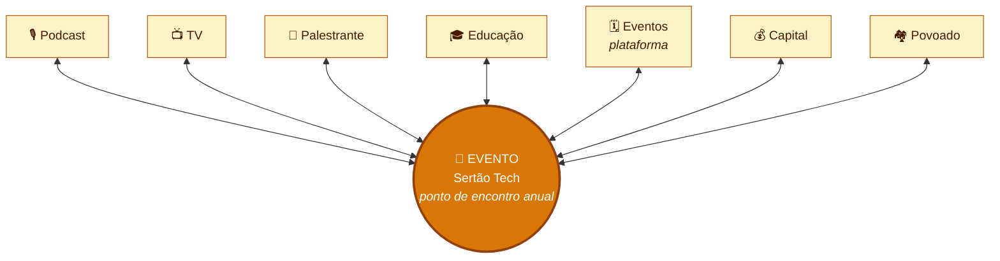
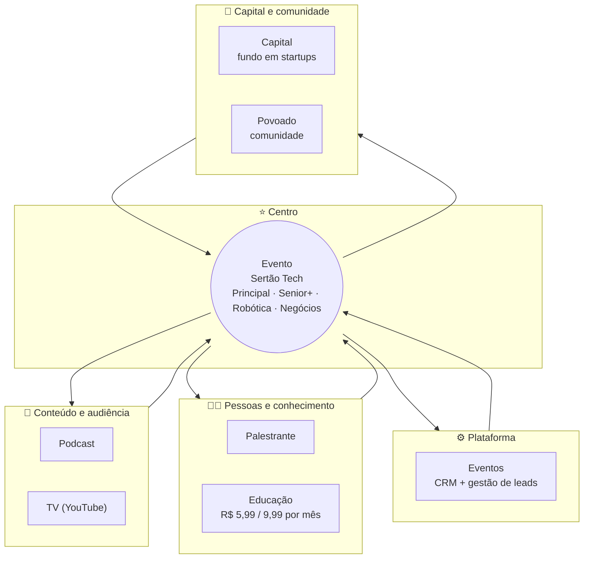
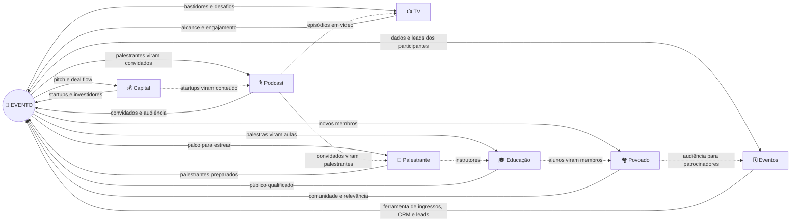
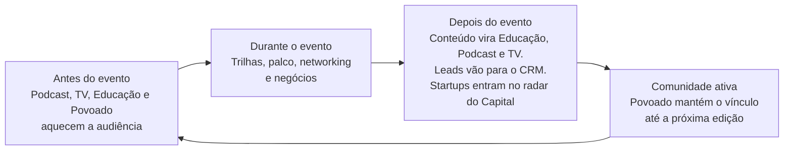

# Ecossistema Sertão Tech

O **Sertão Tech** é um ecossistema de tecnologia do sertão. Ele reúne oito movimentos que se alimentam entre si. No centro está o **Evento Sertão Tech**, o ponto de encontro anual. Os outros sete movimentos mantêm a comunidade ativa o ano inteiro e fazem o evento crescer.

> **Ideia central:** o evento é a vitrine e o momento de encontro. Os demais movimentos produzem conteúdo, formam pessoas, geram capital e dão relevância ao Sertão Tech para patrocinadores e parceiros.

---

## 1. Mapa geral

---

## 2. Estrutura em camadas

Os movimentos se agrupam por função: **conteúdo**, **pessoas**, **plataformas** e **capital e comunidade**.

---

## 3. Como os movimentos se relacionam

Este diagrama mostra o que cada movimento **entrega ao evento** e o que **recebe dele**. Além disso, os movimentos se conectam entre si, sem passar sempre pelo evento.

---

## 4. O ciclo anual

O ecossistema funciona em ciclo. O evento acontece uma vez por ano, e os outros movimentos trabalham antes e depois dele.

---

## 5. Descrição dos movimentos

### 🎪 1. Evento Sertão Tech: o centro

**O que é:** o ponto de encontro anual da tecnologia do sertão. É o movimento mais visível e a origem de tudo.

**Como funciona:** o evento é organizado em **quatro trilhas**:

| Trilha | Foco |
|---|---|
| **Principal** | Conteúdo geral de tecnologia para todos os públicos. |
| **Senior+** | Conteúdo avançado para profissionais experientes. |
| **Robótica** | Prática e demonstrações de robótica. |
| **Negócios** | Empreendedorismo, mercado, investimento e conexões comerciais. |

**Papel no ecossistema:** todos os outros movimentos convergem para o evento ou partem dele. É onde o público se encontra, os patrocinadores aparecem e os demais movimentos se mostram.

---

### 🎙️ 2. Sertão Tech Podcast

**O que é:** podcast com convidados especiais e palestrantes.

**Para quê serve:** mantém a audiência conectada ao ecossistema o ano inteiro. Dá voz a quem passa pelo palco do evento e traz novos nomes que podem virar palestrantes.

**Relação com o evento:** os palestrantes do evento viram convidados do podcast, e os convidados do podcast viram candidatos ao palco. O podcast também divulga o evento.

---

### 🎤 3. Sertão Tech Palestrante

**O que é:** atividades de desenvolvimento de comunicação para palestrantes.

**Para quê serve:** prepara quem quer subir ao palco, com treino de fala, construção de narrativa e presença. O objetivo é elevar o nível das palestras, do evento e da região.

**Relação com o evento:** abastece o palco com palestrantes mais bem preparados. O evento é o lugar onde quem foi formado estreia ou evolui. Os melhores também podem virar instrutores da Educação.

---

### 📺 4. Sertão Tech TV

**O que é:** atividades, desafios e entretenimento no YouTube.

**Para quê serve:** dá alcance e leveza à marca. Mostra a tecnologia de forma divertida e acessível, e alcança quem ainda não conhece o evento.

**Relação com o evento:** mostra os bastidores, dá visibilidade às trilhas (especialmente a Robótica) e transforma pessoas e momentos do evento em conteúdo. Também recebe episódios do podcast em vídeo.

---

### 🎓 5. Sertão Tech Educação

**O que é:** plataforma online com vários instrutores, por assinatura acessível de **R$ 5,99 ou R$ 9,99 por mês**.

**Para quê serve:** leva formação em tecnologia ao longo do ano, a preço baixo, para quem não pode pagar cursos caros. Gera receita recorrente para o ecossistema e renda para os instrutores.

**Relação com o evento:** palestras e conteúdos do evento viram aulas. Os alunos formam o público que lota as próximas edições. Palestrantes formados pelo Palestrante podem virar instrutores.

---

### 🗓️ 6. Sertão Tech Eventos

**O que é:** plataforma de eventos recorrentes, com **CRM e gestão de leads**.

**Para quê serve:** é a base tecnológica para organizar eventos de forma repetível. Cuida de inscrição, credenciamento e relacionamento com os participantes. Também centraliza contatos e leads para que a comunidade e os patrocinadores sejam bem atendidos.

**Relação com o evento:** o evento anual roda sobre essa plataforma. Ela guarda a memória de todas as edições (participantes, contatos, histórico) e pode ser usada em outros eventos recorrentes, como encontros menores, caravanas e meetups.

---

### 💰 7. Sertão Tech Capital

**O que é:** fundo de investimento em startups de tecnologia.

**Para quê serve:** investe em startups, com foco em negócios nascidos ou ligados ao ecossistema. Cria um caminho entre ideia, comunidade e capital.

**Relação com o evento:** a trilha **Negócios** é a porta de entrada. Lá aparecem startups, investidores e conexões. O evento gera o *deal flow* do fundo, e as startups investidas ganham palco, podcast e TV.

> Detalhes em [`../capital/`](../capital/) e [`../docs/PLANO-SERTAO-TECH-CAPITAL.md`](../docs/PLANO-SERTAO-TECH-CAPITAL.md).

---

### 🏘️ 8. Sertão Tech Povoado

**O que é:** construção de comunidade para tornar o Sertão Tech mais relevante para patrocinadores e parceiros.

**Para quê serve:** um evento anual traz público uma vez por ano, e uma comunidade ativa traz público o ano todo. O Povoado organiza as pessoas (alunos, palestrantes, startups, participantes) em uma rede viva. Isso dá aos patrocinadores um público contínuo e engajado, e não só um dia de evento.

**Relação com o evento:** o Povoado dá ao evento relevância, volume e fidelidade. É o argumento mais forte para patrocinadores e parceiros, porque transforma audiência em comunidade.

---

## 6. Resumo em uma tabela

| # | Movimento | O que é | Formato | Papel para o evento |
|---|---|---|---|---|
| 1 | **Evento** | Ponto de encontro anual, com 4 trilhas | Presencial, anual | **Centro do ecossistema** |
| 2 | **Podcast** | Conversas com convidados e palestrantes | Áudio e vídeo, recorrente | Audiência e curadoria de palestrantes |
| 3 | **Palestrante** | Desenvolvimento de comunicação | Atividades de formação | Palco com mais qualidade |
| 4 | **TV** | Desafios e entretenimento | YouTube | Alcance e bastidores |
| 5 | **Educação** | Plataforma de cursos, R$ 5,99 ou R$ 9,99/mês | Online, assinatura | Público formado e receita recorrente |
| 6 | **Eventos** | Plataforma com CRM e leads | Software, recorrente | Infraestrutura e memória de dados |
| 7 | **Capital** | Fundo em startups de tecnologia | Investimento | Trilha Negócios e deal flow |
| 8 | **Povoado** | Comunidade de pessoas e organizações | Rede contínua | Relevância para patrocinadores |

---

## 7. Como ler este ecossistema

- **Para o público:** o evento é a porta de entrada, e os outros movimentos permitem continuar o ano inteiro.
- **Para palestrantes:** Palestrante forma, o evento recebe, o Podcast e a TV amplificam, e a Educação perpetua.
- **Para startups:** a trilha Negócios dá visibilidade, o Capital investe e o Povoado abre contatos.
- **Para patrocinadores e parceiros:** o Povoado, a TV, o Podcast e a Educação mostram que a audiência está presente o ano todo. O evento é o ponto mais forte de contato.

---

## Status dos movimentos

> Preencher conforme cada movimento avançar.

| Movimento | Status | Documento de referência |
|---|---|---|
| Evento | Em operação | [`../docs/PLANO-2027.md`](../docs/PLANO-2027.md) |
| Podcast | _a registrar_ | |
| Palestrante | _a registrar_ | |
| TV | _a registrar_ | |
| Educação | _a registrar_ | |
| Eventos | _a registrar_ | |
| Capital | Em planejamento | [`../docs/PLANO-SERTAO-TECH-CAPITAL.md`](../docs/PLANO-SERTAO-TECH-CAPITAL.md) |
| Povoado | _a registrar_ | |
